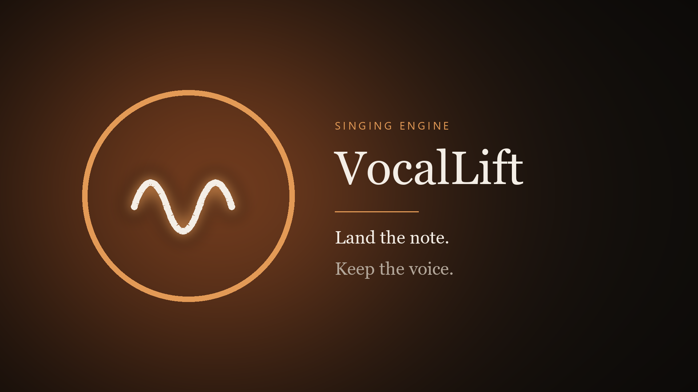
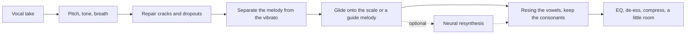

# VocalLift



VocalLift is a singing engine for a voice that can hear the melody and cannot quite hold it. It rebuilds the cracks, pulls each note into the key — or onto a guide track of the tune — and leaves the vibrato alone.

It is not a text-to-song generator. A model like Suno writes a performance that never happened. VocalLift starts from the take you sang and makes *that* performance land.

On the included synthesized phrase, sour by about **37 cents** with one octave crack and one dropout, the engine finishes **4 cents** off the notes it was reaching for. A take sung a minor third flat, which snap-to-scale would drag onto the wrong degrees, follows a guide melody from **132 cents** off to **7**.

## Run the booth

```bash
python -m venv .venv && source .venv/bin/activate
pip install -r requirements.txt
python -m vocallift serve
```

Open [http://127.0.0.1:8000](http://127.0.0.1:8000). Drop a vocal, record one, or play either demo. The off-key demo is the snap-to-key path. "Follow the melody" is a flat take plus a guide track of the tune.

`pyworld` needs a C++ compiler and Python headers (`python3-dev`) the first time it builds.

A single file, no browser:

```bash
python -m vocallift enhance take.wav out.wav --key C --scale major
python -m vocallift enhance take.wav out.wav --guide melody.wav --backing
```

`--backing` also writes `out.mix.wav`, the vocal over a chord bed in the key it used.

## What it actually does



The split is the WORLD vocoder: a pitch contour, a spectral envelope, and an aperiodicity curve. Three things then happen to the pitch, and only the pitch.

**Cracks.** A break qualifies when it is short and the pitch on both sides is the same note — an octave flip under about 85 ms, or a loud dropout under about 90 ms. A real leap, a breath, and a consonant are left alone. The contour is interpolated back through the hole.

**Intent, vibrato, jitter.** A short median filter pulls out the slow melody. What is left, and is slower than about 12 Hz, is treated as vibrato and kept at full depth unless you turn it down. Faster wobble is discarded. Notes that were sung dead straight can grow a delayed vibrato if you ask for it.

**The target.** By default each note glides toward the nearest tone in the key. The key is either one you set or one estimated from how close the take already sits to each scale. Strength is how far the note travels, tightness is how hard a drift inside the note gets pulled back to its center, and the glide time is how fast it moves. Because only the slow layer moves, a wide vibrato does not get sheared into a staircase.

Past about half a semitone the nearest scale tone can be the neighbor, especially between B and C or E and F. That is what the guide track is for. When you sing the same number of notes as the guide, each of your notes inherits the guide's pitch and keeps your timing. When you don't — a monotone, a lost phrase — the guide is time-stretched across the performance and the targets follow it.

The vowels are resynthesized from your own spectral envelope at the new pitch. Consonants and breaths come from the original recording, crossfaded over about 12 ms. A light master follows: a high pass, a presence lift, a de-esser, a compressor, and an optional short room.

## Fine-tune the resynthesizer

The signal path above needs no training. The network is a second voice you can grow.

It is a small differentiable harmonic-plus-noise synthesizer. Training does not need paired "bad take / good take" recordings:

1. Synthesize a clean sung phrase at a known pitch.
2. Damage a copy — shift it, drop in a brief octave crack, add noise, punch a short hole.
3. Give the network the damaged audio and the clean pitch, and ask it to sing the clean phrase back.

It has to read the vowel from the damaged recording and follow the pitch it was handed. In the booth, that pitch is the melody the signal engine already corrected.

[`notebooks/VocalLift_Colab.ipynb`](notebooks/VocalLift_Colab.ipynb) does this, then optionally fine-tunes on dry recordings of one voice: reconstruct them from their own pitch, and again from a noisy copy.

[Open it in Colab](https://colab.research.google.com/github/AaronGrace978/Voice-Enhancer/blob/cursor/vocallift-platform-865a/notebooks/VocalLift_Colab.ipynb).

Or locally:

```bash
python -m vocallift train --steps 200 --out checkpoints/vocallift.pt
python -m vocallift train --init checkpoints/vocallift.pt --finetune verse.wav scales.wav --finetune-steps 80
```

Put the file at `checkpoints/vocallift.pt` (or point `VOCALLIFT_CHECKPOINT` at it) and enable **Neural resynth** in the booth. The resynthesis is 16 kHz — the signal engine stays full band, and it is the one to use until a checkpoint has actually heard the voice you care about. If the checkpoint is missing, the booth tells you and carries on without it.

## Tests

```bash
pytest
```

The suite checks crack repair against a real melodic leap, vibrato surviving a full-strength retune, a guide pulling a flat phrase onto the melody, the booth's demo endpoint, and that a few training steps lower the resynthesis loss.

## Limits

Takes are capped at 45 seconds. Pitch tracking is Harvest by default; the faster DIO option will slip an octave more often. The neural model starts from synthetic vowels, so it will not sound like a particular person until it is fine-tuned on them, and even then it is a 16 kHz voice. There is no accompaniment generator beyond the preview chord bed, and no lyric or melody transcription.
