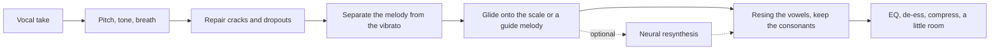

# VocalLift


VocalLift is a singing engine for a voice that can hear the melody and cannot quite hold it. It rebuilds the cracks, pulls each note into the key — or onto a guide track of the tune — and leaves the vibrato alone.

It is not a text-to-song generator. A model like Suno writes a performance that never happened. VocalLift starts from the take you sang and makes *that* performance land.

On the included synthesized phrase, sour by about **37 cents** with one octave crack and one dropout, the engine finishes **4 cents** off the notes it was reaching for. A take sung a minor third flat, which snap-to-scale would drag onto the wrong degrees, follows a guide melody from **132 cents** off to **7**.

It also has **voice skins**: record a few minutes of a voice, and anyone can speak (or sing) into that skin and come out sounding like them. No singing is needed to make one or to use one. See [Voice skins](#voice-skins).

## Download

[v0.2.1](https://github.com/AaronGrace978/Voice-Enhancer/releases/tag/v0.2.1) is built for Windows, macOS, and Linux. Unzip the archive and keep the folder together. Nothing else to install. PyTorch is inside the app, so the neural voice-skin engine runs without a separate install. The first time you pick it, the booth downloads its weights (about 1.3 GB) and keeps them.

| Platform | File |
| --- | --- |
| Windows | `VocalLift-0.2.1-windows-x64.zip` |
| macOS Apple Silicon | `VocalLift-0.2.1-macos-arm64.tar.gz` |
| macOS Intel | `VocalLift-0.2.1-macos-x64.tar.gz` |
| Linux | `VocalLift-0.2.1-linux-x64.tar.gz` |

On Windows, double-click `VocalLift.exe`. On macOS or Linux, open a terminal in that folder and run `./VocalLift`. The booth opens at [http://127.0.0.1:8000](http://127.0.0.1:8000).

These builds are unsigned. Windows SmartScreen and macOS Gatekeeper ask you to confirm the first launch. On a Mac, right-click `VocalLift` and choose Open.

The download is the booth, the signal engine, and both voice-skin engines. Training the singing resynthesizer stays in the Colab notebook. Put a finished checkpoint next to the program at `checkpoints/vocallift.pt` and turn on Neural resynth.

## Run from source

```bash
python -m venv .venv && source .venv/bin/activate
pip install -r requirements.txt
python -m vocallift serve
```

Open [http://127.0.0.1:8000](http://127.0.0.1:8000). Drop a vocal, record one, or play either demo. The off-key demo is the snap-to-key path. "Follow the melody" is a flat take plus a guide track of the tune.

`pyworld` needs a C++ compiler and Python headers (`python3-dev`) the first time it builds.

A single file, no browser:

```bash
python -m vocallift enhance take.wav out.wav --key C --scale major
python -m vocallift enhance take.wav out.wav --guide melody.wav --backing
```

`--backing` also writes `out.mix.wav`, the vocal over a chord bed in the key it used.

## Voice skins

A voice skin is a voice someone recorded and chose to share. Anyone can send audio through it and hear it come back in that voice. The words, the timing, and the melody stay with whoever is performing. The tone is the owner's.

1. **Make a skin.** The owner reads anything aloud for two to five minutes. Several files are fine, and so is a phone recording in a quiet room.
2. **Speak through it.** Anyone records themselves talking. The output says what they said, in the owner's voice.

In the booth, scroll to **Voice skins** (or click the link at the top). From the command line:

```bash
# The owner: learn the voice. --consent is required.
python -m vocallift skin build me-reading-1.wav me-reading-2.m4a --owner "Ada Lovelace" --consent --terms "credit me, non-commercial"

# Anyone: say something in that voice.
python -m vocallift skin speak my-line.wav as-ada.wav --voice "Ada Lovelace"
python -m vocallift skin speak my-line.wav as-ada.wav --voice "Ada Lovelace" --engine neural

python -m vocallift skin list
```

Skins live in `voices/<owner>/` (or wherever `VOCALLIFT_VOICES` points). Useful options for `speak`:

| Option | What it does |
| --- | --- |
| `--engine signal` | The default. Instant, offline, no download. |
| `--engine neural` | kNN-VC. Sounds most like the owner. PyTorch ships with the app. The weights (about 1.3 GB) download once, or run `python -m vocallift skin neural-download`. |
| `--amount 0.7` | How far to go toward the owner. 0 leaves the speaker, 1 is all owner. |
| `--pitch keep` | Leave the melody alone, for singing through a skin. The default, `match`, moves the speaker's pitch into the owner's range. |
| `--shift -12` | Extra semitones on top of the pitch mode. |

### How it works

There are two engines. Neither one needs training on the owner, only their recordings.

**Signal engine.** It splits both voices with the WORLD vocoder (pitch, spectral envelope, breathiness), and then three things happen:

- **The words.** Every 5 ms frame of the speaker is matched to the owner frames that make the same sound. Matching uses the coarse shape of the envelope, normalized per voice, with a little context on each side. The owner's real envelopes and breathiness for that sound are averaged in.
- **The vocal tract.** The speaker's whole envelope is stretched along the frequency axis until it lines up with the owner's average, and the owner's long-term tone color is applied on top. This keeps every consonant and vowel exactly as it was said. Half of each frame comes from this and half from the matched owner frames (`--detail` sets the split).
- **The pitch.** It is moved from the speaker's range into the owner's, preserving the speaker's intonation: a rise is still a rise, it just starts from where the owner talks.

**Neural engine.** This is [kNN-VC](https://github.com/bshall/knn-vc) (Baas, van Niekerk & Kamper, Interspeech 2023, MIT license). The encoder and vocoder code ship with VocalLift. It does the same matching on WavLM speech features and turns them back into audio with a HiFi-GAN vocoder trained for exactly that. It sounds the most like the owner, and it gets better with more audio, up to about five minutes. The first use downloads the weights, about 1.3 GB, into the torch hub cache (or wherever `VOCALLIFT_NEURAL_WEIGHTS` points). In the booth, choose Neural and press the download button. The progress bar stays on the page until it is ready.

### How well it works

[`scripts/eval_skin.py`](scripts/eval_skin.py) downloads two CMU ARCTIC speakers. It builds a skin from 100 sentences by *slt* (a woman), then converts 15 *other* sentences read by *bdl* (a man). Each output is scored against slt reading the same sentence. Mel-cepstral distortion (MCD, after time alignment) measures how far the voice is from slt's. Word error rate, from a wav2vec 2.0 recognizer, measures whether the words survived.

| | MCD to slt (lower is closer) | Word error rate |
| --- | --- | --- |
| bdl, unconverted | 13.32 dB | 4.3% |
| Signal engine | 10.59 dB | 6.7% |
| Neural engine | **9.31 dB** | **3.5%** |
| slt herself, through the signal pipeline | 7.13 dB | — |

The last row is the floor: what resynthesis costs even with nothing to convert. Both engines also land the pitch. bdl talks around 122 Hz and slt around 185 Hz, and the converted sentences come out at 186 Hz.

```bash
python scripts/eval_skin.py --asr                 # signal engine
python scripts/eval_skin.py --asr --engine neural
```

### Consent and provenance

A skin only exists because its owner said yes:

- A skin will not build without an owner's name and `--consent` (the booth has a checkbox). That is the person confirming the recordings are their own voice, or that the speaker agreed to share it. The statement and date are stored in `skin.json`, along with any terms the owner set. The booth shows those terms next to the voice.
- Every file a skin produces carries a WAV comment: *"Synthetic voice: <owner> voice skin, made with VocalLift. Not a recording of <owner>."*

Do not build a skin from someone else's recordings without their permission, and do not use one to pass off words as something a person really said.

## What it actually does



The split is the WORLD vocoder: a pitch contour, a spectral envelope, and an aperiodicity curve. Three things then happen to the pitch, and only the pitch.

**Cracks.** A break qualifies when it is short and the pitch on both sides is the same note — an octave flip under about 85 ms, or a loud dropout under about 90 ms. A real leap, a breath, and a consonant are left alone. The contour is interpolated back through the hole.

**Intent, vibrato, jitter.** A short median filter pulls out the slow melody. What is left, and is slower than about 12 Hz, is treated as vibrato and kept at full depth unless you turn it down. Faster wobble is discarded. Notes that were sung dead straight can grow a delayed vibrato if you ask for it.

**The target.** By default each note glides toward the nearest tone in the key. The key is either one you set or one estimated from how close the take already sits to each scale. Strength is how far the note travels, tightness is how hard a drift inside the note gets pulled back to its center, and the glide time is how fast it moves. Because only the slow layer moves, a wide vibrato does not get sheared into a staircase.

Past about half a semitone the nearest scale tone can be the neighbor, especially between B and C or E and F. That is what the guide track is for. When you sing the same number of notes as the guide, each of your notes inherits the guide's pitch and keeps your timing. When you don't — a monotone, a lost phrase — the guide is time-stretched across the performance and the targets follow it.

The vowels are resynthesized from your own spectral envelope at the new pitch. Consonants and breaths come from the original recording, crossfaded over about 12 ms. A light master follows: a high pass, a presence lift, a de-esser, a compressor, and an optional short room.

## Fine-tune the resynthesizer

The signal path above needs no training. The network is a second voice you can grow.

It is a small differentiable harmonic-plus-noise synthesizer. Training does not need paired "bad take / good take" recordings:

1. Synthesize a clean sung phrase at a known pitch.
2. Damage a copy — shift it, drop in a brief octave crack, add noise, punch a short hole.
3. Give the network the damaged audio and the clean pitch, and ask it to sing the clean phrase back.

It has to read the vowel from the damaged recording and follow the pitch it was handed. In the booth, that pitch is the melody the signal engine already corrected.

[`notebooks/VocalLift_Colab.ipynb`](notebooks/VocalLift_Colab.ipynb) does this, then optionally fine-tunes on dry recordings of one voice: reconstruct them from their own pitch, and again from a noisy copy.

[Open it in Colab](https://colab.research.google.com/github/AaronGrace978/Voice-Enhancer/blob/cursor/vocallift-platform-865a/notebooks/VocalLift_Colab.ipynb).

Or locally:

```bash
python -m vocallift train --steps 200 --out checkpoints/vocallift.pt
python -m vocallift train --init checkpoints/vocallift.pt --finetune verse.wav scales.wav --finetune-steps 80
```

Put the file at `checkpoints/vocallift.pt` (or point `VOCALLIFT_CHECKPOINT` at it) and enable **Neural resynth** in the booth. The resynthesis is 16 kHz — the signal engine stays full band, and it is the one to use until a checkpoint has actually heard the voice you care about. If the checkpoint is missing, the booth tells you and carries on without it.

## Tests

```bash
pytest
```

The suite checks crack repair against a real melodic leap, vibrato surviving a full-strength retune, a guide pulling a flat phrase onto the melody, the booth's demo endpoint, and that a few training steps lower the resynthesis loss. For voice skins it checks that a skin refuses to build without consent, that a synthetic low voice comes out in a higher owner's range and tone color with every vowel still the vowel that was said, that the booth can build a skin and speak through it, and that the output is tagged.

## Limits

Takes are capped at 45 seconds. Pitch tracking is Harvest by default; the faster DIO option will slip an octave more often. The neural model starts from synthetic vowels, so it will not sound like a particular person until it is fine-tuned on them, and even then it is a 16 kHz voice. There is no accompaniment generator beyond the preview chord bed, and no lyric or melody transcription.

Voice skins convert up to five minutes at a time. The signal engine works at 24 kHz, and the neural engine at 16 kHz. Both work best on clean, dry speech from one person; background music or a second voice in the owner's recordings will leak into the skin. Neither engine copies an accent or speaking style; it copies the sound of the voice. For a closer match on singing, fine-tune the resynthesizer on the owner's takes as described above. The downloadable builds include PyTorch, so they are larger than 0.2.0. The neural weights are a separate one-time download, because bundling 1.3 GB into every platform archive would make the release several times bigger.
